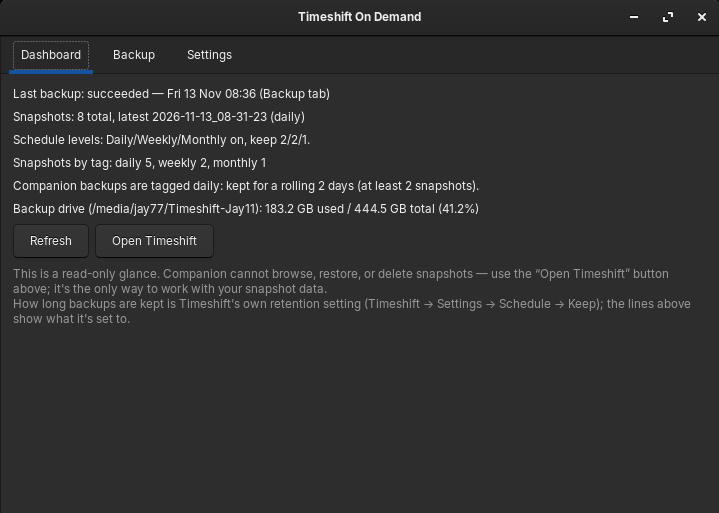
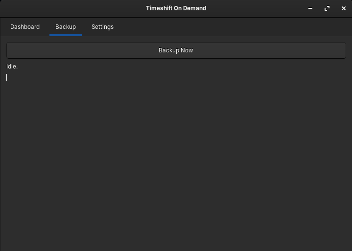
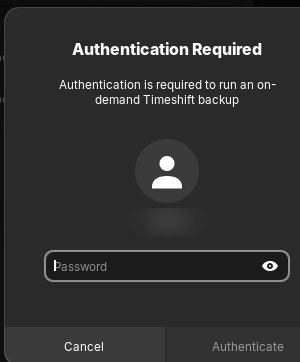
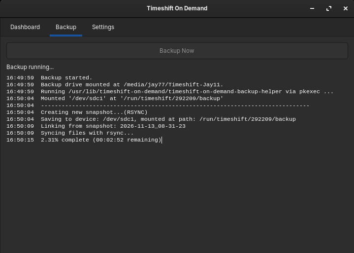
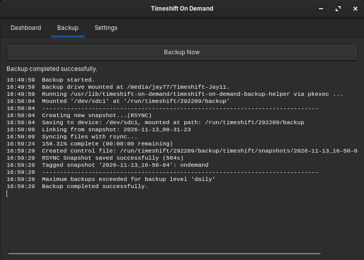
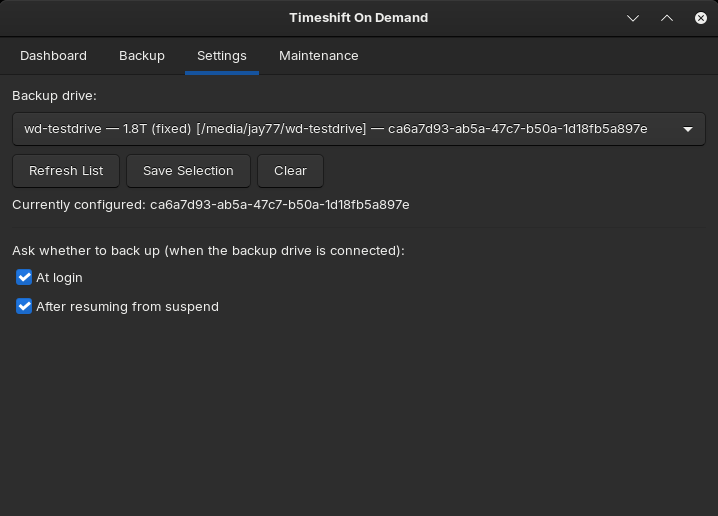

# Usage guide

Companion has three tabs, a tray icon, and two optional auto-prompts.
This walks through all of them.

## Dashboard tab

A read-only glance:

- **Last backup** — the first line, because it answers "did my last backup
  work?": succeeded or **FAILED**, when, whether it was started
  from the Backup tab or the login/resume prompt, and for a failure the
  reason in plain words. It covers runs that actually started the backup;
  a run that never got going (drive not plugged in, you answered No at
  the prompt, or you dismissed the password dialog) leaves it unchanged, so
  a failure keeps showing until a backup succeeds. A backup can leave a
  plausible-looking snapshot behind and still have failed, so check this
  line rather than the snapshot list.
- **Snapshots** — total count, the latest snapshot and its current
  Timeshift tag, read straight from Timeshift's snapshot folders on the
  backup drive. No password needed; the drive just has to be mounted.
  If a snapshot folder exists without Timeshift's `info.json`, it's shown
  as "incomplete" (a backup still running, or one that didn't finish).
- **Retention** — how long Timeshift keeps your backups, read from its
  settings (Timeshift → Settings → Schedule). It shows, in this order:
  - The schedule levels that are on and what each keeps, for example
    "Daily/Weekly/Monthly on, keep 2/2/1". This is the line to act on.
  - Snapshots per tag. One snapshot can carry more than one tag, so these
    can add up to more than the total on the Snapshots line; hover over
    the line for that explanation.
  - "Companion backups are tagged daily: kept for a rolling N days (at
    least N snapshots)", where N is Timeshift's daily "Keep" count. That
    count applies even if the Daily level is switched off.
  - A bold warning when neither Weekly nor Monthly is on: *"No weekly or
    monthly restore points are scheduled …"*. Only those levels make
    restore points older than the daily window, so history then goes
    back just a few days. To keep longer history, enable Weekly and/or
    Monthly in Timeshift → Settings → Schedule.

  These rules are Timeshift 24.01.1's, taken from its source and checked
  against real snapshots; other versions haven't been checked.
- **Backup drive** — usage of the drive Timeshift is set up to back up to
  (Timeshift → Settings → Location), if it's currently mounted. If
  Timeshift has no backup device yet, this says so.
- **Refresh** / **Open Timeshift** — Refresh re-fetches both; Open
  Timeshift launches the real Timeshift GUI for anything beyond this
  glance.

The advisory text under the buttons says the Dashboard is a read-only
glance: Companion cannot browse, restore, or delete snapshots, and how
long backups are kept is Timeshift's own retention setting. See
[troubleshooting.md](troubleshooting.md#how-long-backups-are-kept) for
how that works.

The Dashboard refreshes itself every 30 seconds, after every backup,
and when you click Refresh.

## Backup tab

Click **Backup Now** to trigger an on-demand backup immediately — no
time-of-day restriction, works any time the configured drive is
mounted.

A `polkit` authentication dialog appears next — enter your password (or
use fingerprint/PIN if your system supports it) to actually authorize
the backup. See
[Understanding privilege prompts](#understanding-privilege-prompts)
below for why this is asked separately from your login password.

While running, the button disables and the status line updates. The log
below streams the backup's output live (Timeshift's percentage updates
replace one line in place, as in a terminal) —
useful for diagnosing a failure without needing to go find a log file.

Quitting Companion (tray → Quit) while a backup is running doesn't
cancel it: the backup itself carries on to completion in the
background, it just won't be shown in the window anymore. Its outcome
still lands in Timeshift's own logs.

A completed run shows the outcome and the drive gets a fresh snapshot in
Timeshift. A failed run says why in plain words, for example that the output
shows write errors on the backup drive, instead of only an exit code.

If you start a backup from the tray while the window is hidden (or in the
background), a desktop notification tells you when it finished. A failure
always notifies, even with the window in front, and stays on screen until
you dismiss it. A run that never started (for example, Timeshift has no
backup device) also gets a short notice. The login/resume prompt notifies
when it finishes too.

## Settings tab

There is no drive to pick here. Backups go to the drive chosen in
Timeshift itself (Timeshift → Settings → Location), and that's the one
Companion waits for, so there's only one place to set it. The Dashboard
shows its status, and **Open Timeshift** takes you to Timeshift to change
it. See
[troubleshooting.md](troubleshooting.md#timeshift-has-no-backup-device-set)
if Companion says Timeshift has no backup device.

Older versions had a drive dropdown of their own. If you used it, that
choice is now ignored and removed from your settings file the next time
you change a setting here.

The two checkboxes here turn the
[login and resume prompts](#auto-prompts-login-and-resume) on or off
separately. Both start on, and a change applies from the next login or
resume.

## Tray icon

If your desktop environment supports AppIndicator (most GNOME-based
ones do, with the right extension), Companion runs a tray icon with:

- **Backup Now** — same as the Backup tab's button. While a backup is
  running (from the tab or the tray) it reads **Backup running…**, can't
  be clicked, and the tray icon changes to a "syncing" icon; both go back
  to normal when the run ends, however it ends. This only follows backups
  started from the tab or the tray. The login/resume prompt has its own
  window.
- **Show Window** — brings the main window back (closing the window
  hides it rather than quitting, precisely so the tray/auto-prompts keep
  working).
- **Quit** — actually exits.

## Auto-prompts (login and resume)

Independent of the main window entirely — these fire even if Companion
was never manually opened (unless turned off in the Settings tab):

1. A `zenity` Yes/No dialog: *"Do you want to start the on-demand
   Timeshift backup now?"*
2. On **Yes**, a small standalone monitor window opens, streaming the
   backup's output live (the percentage updates replace one line in
   place, as in a terminal) — same as the in-app Backup tab's log.
3. It auto-closes a few seconds after a successful finish, or stays
   open until you close it if the backup failed.
4. A desktop notification also appears either way, independent of
   whether you're watching the window.

If the drive isn't mounted when either trigger fires, none of this
appears at all — it waits briefly, then quietly gives up. See
[troubleshooting.md](troubleshooting.md#the-loginresume-prompt-didnt-appear)
if you expected it to show and it didn't.

## Understanding privilege prompts

You'll be asked to authenticate (password/fingerprint, via `polkit`) for
one specific, narrowly scoped thing — Companion itself never runs as
root:

| When | What | How often |
|---|---|---|
| Clicking "Backup Now" / auto-prompt confirm | Creating the actual snapshot | Every time |

Opening the app and viewing the Dashboard never asks for a password.

This is deliberate — Companion depends on `polkit` for authorization
rather than a standing passwordless grant, so every backup
genuinely requires you to say yes each time. See the top-level `README.md`'s
"Privilege model" section for the full reasoning.
